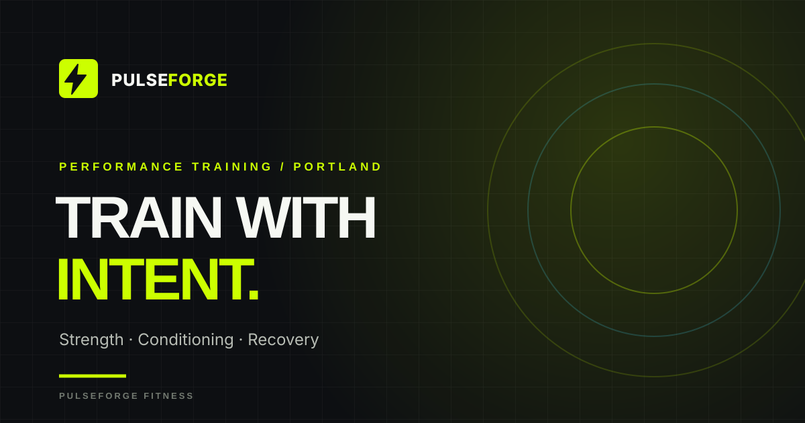

<div align="center">
  
  <h1>PULSEFORGE FITNESS</h1>
  <p><strong>Train with intent. Build what lasts.</strong></p>
  <p>A responsive digital experience for a performance-focused training studio.</p>
  <p>
    <a href="https://pulseforge-fitness-rho.vercel.app/"><strong>Open the live experience →</strong></a>
  </p>
  <p>
    
    
    
    
  </p>
</div>

<p align="center">
  
</p>

## Overview

PulseForge is a mobile-first fitness studio website designed to make training programs, coaching, class times, and membership options easy to explore. Its dark interface, high-contrast lime accents, and compact editorial typography carry the brand consistently from the landing page through its interactive sections.

## Highlights

- **Program discovery** — strength, conditioning, and recovery information presented in a clear, responsive layout.
- **Weekly schedule** — browse classes by day and filter the schedule by training category.
- **Coach profiles** — review coaching specialties, credentials, and experience.
- **Membership comparison** — switch between monthly and annual pricing.
- **Fitness baseline calculator** — estimate BMI and daily maintenance calories from user-entered measurements.
- **Responsive navigation** — accessible mobile menu, section navigation, dialogs, and touch-friendly controls.
- **Search and social metadata** — page title, description, canonical URL, Open Graph, Twitter Card, and branded favicon.

The site is a client-rendered frontend with no server-side data layer. Reservations, contact and newsletter forms, and member-access prompts demonstrate the interface; they do not send or persist submissions.

## Technology

| Layer | Implementation |
| --- | --- |
| UI | React 19, TypeScript, and Wouter |
| Build tooling | Vite 7 |
| Styling | Tailwind CSS 4 with reusable CSS variables |
| Motion and icons | Framer Motion and Lucide React |
| Interface primitives | Radix UI |

## Local development

Requirements: Node.js 20.19+ or 22.12+, and npm.

```bash
npm install
npm run dev
```

Vite prints a local development URL when the server is ready.

## Production build

```bash
npm run typecheck
npm run build
npm run serve
```

The production bundle is written to `dist/public`.

## Project structure

```text
src/
├── components/       # Error boundary and reusable UI primitives
├── hooks/            # Shared React hooks
├── lib/              # Styling utilities
├── pages/            # Route-level views
├── App.tsx           # Site sections, interactions, and routing
├── index.css         # Global theme and utility styles
└── main.tsx          # React entry point
public/               # Favicon and social sharing graphic
```

## Imagery

Training photography is loaded from public Pexels image URLs. An internet connection is required for remote photography to render.

## Deployment

The project is configured for a static Vite deployment. Vercel settings:

| Setting | Value |
| --- | --- |
| Framework preset | Vite |
| Build command | `npm run build` |
| Output directory | `dist/public` |

`vercel.json` routes client-side requests to the application entry point. The live site is available at [pulseforge-fitness-rho.vercel.app](https://pulseforge-fitness-rho.vercel.app/).
